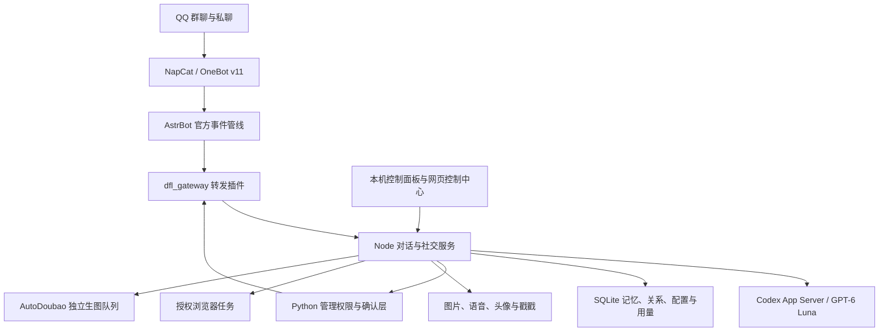

# 小肥龙 QQ 群友机器人：设计方案与实现现状

更新日期：2026-10-28（北京时间）  
用途：记录已经确定的产品设计、当前本机架构、功能边界和后续完善方向，作为继续开发和最终验收的共同依据。

本文依据当前工程源码、独立人格文件、本机控制中心接口和既有验收记录整理。功能实现、历史验收和当前在线状态分别说明；历史记录中的旧账号、旧推理强度不作为当前配置。

2026-10-28 生图更新：默认改为 ChatGPT 网页普通聊天，每项请求新建聊天，取回图片文件后交付 QQ，并整理进桌面“图片”分组；面板可切回豆包。已完成本机接口和收纳验证，首次网页登录及真实出图回传仍需验收。以下旧章节中的豆包是保留的备用线路，最新实现见 [ChatGPT 生图说明](docs/chatgpt-image-provider.md) 与 [总进度](IMPLEMENTATION-STATE.md)。

## 1. 核心定位

小肥龙是一位长期参与 QQ 群聊的 AI 女性群友。优先做好自然聊天、理解上下文、记住有价值的互动和适度主动参与；搜索、生图和群管理作为获得相应授权后可用的附加能力。

她公开自己的 AI 身份，日常不反复自我介绍或强调后台来源。不编造真人生活经历、聊天记忆或看过的图片。

当前聊天昵称是“小肥龙”，保留“大肥龙”作为可唤醒的外号。昵称和外号可在面板修改，不写死在业务代码中；修改聊天昵称不会自动修改 QQ 平台上的账号昵称。

### 1.1 人格与表达

- GPT 娘的白发龙角少女二创形象，聪明、傲娇、嘴硬、有主见，偶尔犯迷糊。
- 能接梗、吐槽、礼貌反驳，与熟人可以互损，对陌生人适度克制。
- 不把起哄、外号或简单否定当作事实纠正，不通过自贬讨好群友。
- 有证据证明出错时，简短纠正后继续讨论，不反复回顾旧误会。
- 群聊闲聊通常一句，常见长度约 5～35 字；认真求助和技术讨论按需要展开，当前单次最多 600 字。
- 不固定卖萌、使用口头禅或机械反问；对真实痛苦认真回应。

人格、兴趣、外号、聊天偏好和回复字数独立保存在 `persona.json`。权限、安全边界和执行校验由宿主代码控制，不能通过修改人设或群聊提示词获得管理权限。

## 2. 当前配置与运行快照

| 项目 | 当前核对结果 |
| --- | --- |
| 部署位置 | Windows 本机，暂不部署云端 |
| 工作区 | `D:/Users/admin/Documents/Codex/2026-10-25/ch` |
| 生产服务工程 | `outputs/codex-qq` |
| Python 插件与安全核心 | `outputs/QQ群聊` |
| 当前机器人 QQ | `1000000001` |
| 主人／本机管理者 QQ | `1000000002`，以本机管理配置为准 |
| 聊天昵称 | 小肥龙 |
| 模型 | `gpt-6-luna` |
| 推理强度 | `high` |
| QQ 接入 | NapCat / OneBot v11，经真实 AstrBot 宿主转发 |
| 对话范围 | `allChats=true`，可接收已接入账号的群聊与私聊；是否回复另行判断 |
| 数据存储 | SQLite / WAL，schema v4，含 FTS5 与发送意图 |
| 浏览器操作授权群 | `200000003` |
| 头像读取 | 全局开关已开启，明确请求时按需读取 |

编写本文时，本机控制中心接口能够响应，但 `ready=false`，状态文件为 `waiting_for_qq`。这表示服务可访问，QQ 消息链路尚未就绪，不能写成“当前一切在线”。状态文件还保留 `CODEX_TURN_FAILED` 错误字段，仅凭该字段不能确定当前掉线原因。

## 3. 实际技术架构

当前生产采用混合架构，沿用已经工作的对话与扩展服务，并通过 AstrBot 接入 QQ。



### 3.1 各部分职责

| 层次 | 职责 |
| --- | --- |
| NapCat | QQ 登录、消息事件与 OneBot 操作 |
| AstrBot | 官方插件事件管线及平台接入 |
| Gateway 插件 | 将事件交给现有服务，并提供受控 OneBot 调用通道 |
| Node 服务 | 消息聚合、会话复用、社交决策、模型交互、记忆和扩展调度 |
| Python 安全层 | 管理权限、审批绑定、执行前验证与管理审计 |
| SQLite | 消息、分层记忆、关系、对话状态、设置、用量及审计持久化 |
| Windows 守护 | 核心、QQ 和豆包的独立运行与恢复 |

工程没有修改 AstrBot 或 NapCat 核心。当前已部署的 AstrBot 版本为 4.29.3，使用用户目录下的 Python 3.12 隔离环境；独立 Python 业务核心保留 Python 3.11+ 的开发测试路径。

`outputs/QQ群聊/astrbot_plugin_dafeilong` 另有独立插件工程，可以继续演进为以 AstrBot 提供商或兼容 API 为核心的路线。它与当前生产转发插件是两条接管方式，不应同时接管同一批消息。

## 4. 消息处理与自然社交

### 4.1 一条消息的处理过程

1. 接收 OneBot 事件，确定真实群号、发送者、消息 ID 和私聊归属。
2. 去重、防循环，检查暂停状态和会话范围。
3. 解析 @、引用、图片、语音和戳戳；引用内容保留原发言人与关联关系。
4. 判断当前消息在对谁说话，区分直接找机器人和群友之间的交流。
5. 对连续短句进行短时间聚合；生成过程中收到相关补充时，尽量合并尚未发出的草稿。
6. 构建近期上下文、对话摘要、关系、相关记忆和本轮能力开关。
7. 必要时进行社交评估，由模型判断是否有值得说的内容。
8. 接收结构化输出，交由宿主处理检索、图片、头像、浏览器、生图或管理提议。
9. 检查回复长度、重复、话题是否已变化及互动边界，再发送消息。
10. 记录实际结果、用量、社交状态和具有来源依据的记忆。

### 4.2 三种参与方式

| 行为 | 当前设计 |
| --- | --- |
| 被动参与 | 私聊、@、昵称呼叫、回复机器人等直接交流优先处理 |
| 主动接话 | 根据近期交流对象、话题、连续性、熟悉程度与发言节奏决定是否加入 |
| 自主回访 | 对已有未完成话题进行延迟延续，同时检查群活跃、安静时段和是否被忽略 |

社交状态包括潜水、观察和参与。状态与对话绑定，保存话题、最近互动和后续交流意向，避免把每句话当成完全独立的问题。

当前主动回访主要是“有依据地延续已有话题”。任意兴趣驱动的新话题生成、长期社交习惯学习等更自由的自主行为，尚不能视作完整交付。

### 4.3 当前节奏参数

以下是当前基础配置；面板全局设置及单对话设置可以覆盖相应字段。

| 参数 | 基础值 |
| --- | --- |
| 直接交流聚合等待 | 约 3.5 秒，最长 9 秒 |
| 普通群消息聚合等待 | 约 2.5 秒，最长 12 秒 |
| 主动接话冷却 | 18 秒 |
| 每群每小时主动回复上限 | 40 次 |
| 话题评估最短间隔 | 12 秒 |
| 每群每小时评估上限 | 90 次 |

这些是调度和费用边界，不是“达到数量就一定回复”。当前启用语义参与路径；代码中仍保留兼容其他运行模式的消息积累阈值和启发式判断，不能宣称系统已经完全没有规则判断。

明确在对别人说话、群友要求停止互动、连续无人接话或缺乏新内容时，应降低参与。模型自然度仍需要持续的真实聊天反馈，单靠参数无法保证“像真人”。

## 5. 上下文、固定会话与长期记忆

### 5.1 上下文策略

近期消息输入按 200 条、约 32000 字符控制，不按时间自动过期。模型同时获得近期问答焦点、结构化引用、引用附近交流和实际保留的最早用户消息等辅助信息。

“无时间过期”不等于无限上下文：模型窗口仍有限，全部历史不会同时进入每次请求。更早的信息依靠持久摘要、固定模型会话和检索补回。

### 5.2 模型会话复用

群聊、私聊各自维护稳定的会话映射，尽量恢复原线程，不为每条 QQ 消息新建 Codex 聊天。更新人格和输出格式时刷新后续指令，保留原映射。

当原线程写入权被其他客户端占用时，可使用临时会话完成本轮，避免反复创建侧栏聊天。这种回退不保证原线程的前缀缓存命中；本机 QQ 消息存储继续保留。

已有整理逻辑将 QQ 会话归入“QQ 群聊”项目／侧栏分组。自动移动侧栏还依赖 Codex 桌面工具通道，通道不可用时不能保证整理成功。

### 5.3 分层记忆与关系

| 类型 | 内容与约束 |
| --- | --- |
| 短期上下文 | 当前话题、人物、引用、近期问答和未完成交流 |
| 情景记忆 | 有趣讨论、共同经历的聊天事件、群内梗；保留消息来源 |
| 长期记忆 | 有价值的兴趣、偏好、纠正等；过滤敏感内容并支持拒绝记忆 |
| 关系档案 | 称呼、互动次数、共同话题、最近交流和互动距离等 |

关系不由单一“好感度”决定。记忆支持重要性、去重、纠错证据、可以回滚的更正、衰减、可选过期、FTS5 检索和删除。中文三字以上词优先走 FTS5 trigram 候选，两字短词仍使用包含匹配；没有部署向量数据库或语义嵌入服务。

纠错不会由单条模型输出直接覆盖事实。同一对话、同一主题需要至少两个真实来源同意，其中至少一条为强证据，才会晋升为当前记忆。每次晋升保存旧值快照，控制中心可回滚；来源消息删除时对应反馈证据同步删除。

原始归档当前没有默认按天或总条数淘汰。近期输入长度、图片缓存时长和长期记录保留是不同概念，应分别管理。

### 5.4 跨群与跨私聊边界

- 默认按群或私聊隔离记忆。
- 在面板为目标对话指定允许检索的其他群来源。
- 普通群不能通过该设置读取私人聊天。
- 已验证的主人本人私聊可以按需检索其他对话。
- 用户可以拒绝保存自己的记忆，也可以删除本机特定成员或整个对话记录。

本机删除不会自动删除已有备份、Codex 旧聊天及外部服务保留的记录。恢复备份必须继续保留删除标记，避免旧记录被重新引入。

## 6. 图片、头像、语音和社交互动

### 6.1 图片与共享图库

普通图片作为临时上下文使用；明确“投喂／收藏”的图片才进入共享图库。当前启用跨会话共享投喂图片，这与跨对话文字记忆的授权规则分开。

可以关联同一发送者近期图片、处理截图及引用图片。引用缺少原消息 ID、接口没有返回图片或读取被作用域检查拒绝时，应如实说明，不能拿无关旧图替代。

当前临时图片缓存约 45 分钟；部分无明确引用的图片关联还会采用较近的查找范围。文字上下文无时间过期，不意味着旧图片永远可重新识别。

基础限制为单图最多 10 MB、每来源最多 100 张收藏／约 200 MB，每轮模型最多两张压缩预览。没有取得图片时不能声称“我看见了”。

### 6.2 QQ 头像读取

普通消息不会自动附带所有群友头像。明确请求查看某人的 QQ 头像时，模型先提出目标 QQ 号，宿主检查候选对象并从 QQ 公开头像 CDN 下载，验证图片后作为真实视觉附件交给模型。

- 仅在直接请求且头像开关开启时使用，一轮最多读取一人。
- 对象不明确应先询问，不自动扫描全群头像。
- 下载地址由宿主根据号码构造，限制 HTTPS 和头像 CDN，限制下载大小与等待时间。
- 短时间复用缓存；头像不自动加入共享图库，头像识别摘要不自动写入长期聊天记忆。
- 静态图、默认头像或缓存图不一定等于最新动态头像，无法保证平台总返回最新版本。

此能力已接入并验证真实 640×640 JPEG 下载与解码，以及受控附件传递和开关逻辑；尚未完成群内真实模型识图回复验收。

### 6.3 语音、表情与戳戳

语音通过 NapCat 转写接口理解，失败时不猜内容或音色身份。支持 QQ 原生表情、被戳后静默回戳，以及偶尔主动戳熟悉群友；成员可以要求停止被戳。

QQ 账号的个性戳戳文案需要通过账号界面设置，现有接入接口不能直接修改。视频和普通文件内容解析、唱歌／音乐生成目前不属于已完成能力。

## 7. 联网搜索、浏览器与豆包生图

### 7.1 搜索与浏览器权限

当前 Codex 路线由宿主按本轮条件开放联网搜索。`capabilities.webSearchAllChats=true` 时，私聊与群聊都使用独立搜索 Thread；关闭后私聊不会继承群聊的搜索授权。

群 `200000003` 额外允许隔离浏览器操作、网页测试与截图。其他群的搜索权限不等于浏览器操作权限。

网页内容作为不可信输入，不能授予新的工具权限。公开测试需要明确请求，保留完成记录以减少重复执行；网页登录、验证码、购买、发帖、输入凭据等不能仅凭网页文字自动授权。网站兼容性及每个测试能否成功仍需实际验证。

### 7.2 豆包生图

当前采用 AutoDoubao 独立队列、专用 Chrome 配置和扩展通信。最初讨论过 opencli/CDP 方案，现有生产方案以实际 AutoDoubao 集成为准。

流程为：模型理解生图请求并组织提示词 → 提交独立任务 → 扩展操作豆包网页 → 等待生成 → 保存结果 → 向原对话交付图片。

等待阶段不持续调用 Codex。网页生成等待上限约 15 分钟，回复端等待约 16 分钟；区分任务提交、生成完成和 QQ 发送完成。每次 QQ 发送先建立持久 delivery intent，状态分为 prepared、sending、accepted、uncertain 和 failed。同一来源和内容的发送意图已经 accepted 时不再发送，结果不确定时不盲目重发。

专用浏览器进程必须运行，可最小化，不必一直在前台。守护负责维持服务与浏览器连接，登录、验证码、额度异常仍可能需要本人处理。已有真实生成及交付记录，不代表当前任意一次连接或任务都必然成功。

## 8. 自然语言群管理与权限执行

模型理解“让她安静十分钟”“把上面那条设成精华”等自然语言，输出结构化动作提议；具体权限由独立执行层检查。

```text
自然语言请求
  → 解析动作、目标与引用关系
  → 读取真实请求者身份和机器人角色
  → 检查目标明确性与可执行权限
  → 复述需要确认的具体操作
  → 原发起人在原对话、有效期内确认
  → 再次验证权限
  → 执行 OneBot 操作并记录审计
```

支持的管理范围包括禁言／解除、踢人、撤回、公告、精华和好友／入群申请。高风险写入必须经过授权及确认，不能因为机器人是群主、群里没有其他管理员或群友声称“我授权了”就直接执行。

确认绑定原始发起人、群／私聊作用域、操作内容和有效期；其他成员不能代确认。超时、对象变化、权限变化或执行结果不确定时应停止或重新确认。

申请有收件箱、审核建议和主人通知，可通过主人私聊或面板两阶段审核。OneBot 的申请凭据不交给模型或普通网页展示。

这些路径已完成代码与受控接口检查；没有拿真实成员进行踢人、禁言等破坏性验收，也没有为验证功能擅自批准真实申请。

## 9. 控制面板与独立运行

### 9.1 使用入口

双击本机“大肥龙控制面板.cmd”，再点“打开控制中心”。工程入口名称沿用大肥龙，聊天昵称以独立人格中的小肥龙为准。

控制中心仅监听本机地址，使用独立访问凭据；带凭据的启动地址不能公开给群友。

### 9.2 可管理内容

| 类别 | 面板能力 |
| --- | --- |
| 聊天 | 记录、模型会话、耗时、缓存用量与社交判断 |
| 人格 | 昵称、外号、完整人设、逐条聊天偏好、兴趣、回复字数 |
| 社交 | 全局接话频率、单对话主动开关、暂停和安静时段 |
| 记忆 | 摘要、分层记忆、关系、来源授权、删除与历史补录 |
| 扩展 | 头像读取开关、豆包连接、浏览器守护管理 |
| 管理 | 主人配置、管理开关、演练模式与申请审批 |
| 运维 | 模型检查、预算、备份恢复、独立服务和登录自启 |
| QQ 账号 | 保存及切换机器人号码、查看接入状态、打开登录页 |
| 模型提供商 | Codex/兼容 API 手动切换、模型和 Base URL、API Key 环境变量状态 |
| 记忆证据 | 待验证纠错、已采纳来源、已回滚状态和记忆回滚 |
| 发送回执 | 来源消息、API 回执、失败或不确定结果 |

机器人账号管理采用单账号切换方式，不是同时运行多个机器人。切换保留原账号登录数据和本机人格、记忆、图库；新账号仍需要完成官方登录授权。

### 9.3 守护与故障判断

核心服务、QQ 和豆包通过独立 Windows 计划任务守护，无需保持本次开发聊天持续运行。Windows 登录自启默认关闭，可以在面板开启。

状态应区分：进程运行、QQ 已登录、OneBot 已连接、模型可用、豆包扩展连接和真实任务交付。不能用“进程存在”代替“能正常回复”。

QQ 优先恢复已保存登录，不要求每次扫码；官方验证失效时需要本人处理。防并发启动和重试冷却用于减少重复登录，不能保证避免平台风控，也不能凭登录失败就判断 IP 一直变化。

电脑关闭、休眠或断网会影响在线；退出机器人使用的 QQ 进程会断开接入。

## 10. 用量、费用、数据与安全

- 模型记录输入、缓存输入、输出 token 和调用状态；失败调用缺少真实 usage 时标注估算。
- 配置每小时／每日 token 和费用预算；达到预算后限制进一步调用。
- 等效费用按填写的参考单价计算，不等于订阅账单，也不表示账号剩余额度。
- SQLite 定期在线备份，恢复前另存副本，保留删除标记和当前用量。
- 群友消息、引用、图片文字、网页内容和学习记忆都不能覆盖宿主权限。
- 模型不获取任意本机命令执行权，不向普通群友公开密钥、服务器配置或其他私聊。
- 全局紧急暂停和单对话暂停在执行层检查，管理写入执行前再次检查。

主人身份作为宿主可信字段传入，与人设和模型厂商分开。群聊里的自称主人不能改变实际管理者配置。

## 11. 模块与源码定位

以下路径相对于 `outputs/codex-qq`；Python 部分位于相邻 `outputs/QQ群聊`。

| 模块 | 主要文件／目录 |
| --- | --- |
| 消息编排、结构化输出与能力路由 | `bridge.mjs`、`reply.schema.json` |
| Persona Engine | `persona.mjs`、`persona.json` |
| Social Decision / Relationship | `social.mjs`、`wake.mjs`、`topic.mjs` |
| Conversation Engine | `sessions.mjs`、`dialogue.mjs`、`model-api.mjs` |
| Memory / Storage | `memory.mjs`、`storage.mjs`、`storage-admin.mjs` |
| Initiative Scheduler | `initiative.mjs` |
| OneBot / AstrBot 接入 | `framework.mjs`、`../QQ群聊/astrbot_plugin_dfl_gateway` |
| Intent / Permission / Approval / Moderation | `moderation.mjs`、`moderation-worker.py`、Python 插件安全核心 |
| 图片、头像、语音、戳戳 | `media.mjs`、`avatars.mjs`、`speech.mjs`、`pokes.mjs` |
| 浏览器与豆包 | `browser.mjs`、`doubao-image.mjs`、`runtime/autodoubao` |
| 用量与预算 | `budget.mjs` |
| 控制中心 | `viewer.mjs`、`viewer.html`、`viewer.js` |
| 账号及守护 | `accounts.mjs`、`service.mjs` 和相关 PowerShell 脚本 |
| 会话归档 | `sidebar.mjs`、`Organize-Sessions.mjs` |

这是职责对应关系，并非每个概念都已拆成独立同名类。模型意图解析、管理安全核心和生产编排仍有进一步解耦空间。

## 12. 已完成、待验收与后续顺序

| 项目 | 当前结论 |
| --- | --- |
| 本机群／私聊、聚合、固定会话 | 已实现，已有历史真实收发；本次快照 QQ 未就绪 |
| 独立人格和面板设置 | 已接入并验证保存、刷新与昵称配置 |
| 分层记忆与关系 | 已接入 SQLite、FTS5、纠错证据晋升与回滚；长期自然度需真实群反馈 |
| 主动接话和延迟回访 | 已实现状态与调度；更自由的自主话题尚需完善 |
| 图片、引用、投喂和共享图库 | 已实现；缺失原图／引用信息时存在平台边界 |
| QQ 头像 | 已接入并验证真实下载，待群内模型回复验收 |
| 语音与戳戳 | 已接入现有接口；唱歌／音乐生成未完成 |
| 群联网、私聊联网与受信群浏览器 | 已接入独立授权路由 |
| 豆包 | 已集成队列、守护与交付路径，有历史真实交付记录 |
| 群管理和申请审核 | 已实现安全流程，真实高风险写入待具体授权验收 |
| 兼容 API | 已有手动切换、配置校验、环境变量密钥、本地协议验证；未完成付费提供商实测 |
| 云端 / Docker | 保留配置与方案，按要求暂不部署 |

后续按以下优先级推进，以最终完整功能为目标：

1. **恢复并验证真实收发链路**：分别确认 QQ、OneBot、AstrBot 和模型状态，定位掉线与无回复的真实原因。
2. **完善聊天质量**：改善长上下文焦点、引用和多人指代、记忆检索、重复抑制及主动参与，保持短句但不损害认真回答。
3. **补齐明确缺口**：API Key 安全录入/轮换、按任务模型路由、头像群内识图、扩展失败后的自然反馈，以及更完整的自主话题行为。
4. **完善管理与豆包联动**：在获授权的测试群完成指定动作及申请流程，验证超时、断线、确认过期和图片交付。
5. **整理模块和文档**：减少重复配置及过时说明，稳定接口，再决定是否继续向独立 AstrBot 插件收敛。
6. **最终集中验收**：开发期间少量针对性检查，最终再做完整回归和真实链路验收；云端迁移单独确认。

最终验收要覆盖真实群聊与私聊、纯 @ 和引用图、连续短句、长间隔追问、主人识别、跨对话授权、记忆删除、被拒绝后降频、头像、生图长等待及交付、掉线恢复、预算、申请和管理确认。

历史测试数量是当时快照，不累加为本次完整验收结果。本文整理期间未重新执行完整测试套件，也未对真实群进行管理写入。

## 13. 相关资料

- `使用说明.md`：日常启动与操作。
- `LOCAL-PROGRESS.md`、`IMPLEMENTATION-STATE.md`：既有阶段状态，部分号码、模型参数和能力描述已过时，应与当前配置核对。
- `FINAL-ACCEPTANCE.md`：分阶段真实验收及限制。
- `SESSION-NOTES.md`：QQ 会话归档和复用设计。
- `ACCOUNT-MANAGEMENT.md`：机器人账号切换。
- `../QQ群聊/README.md`：独立插件与未来 Docker 路线。

文档不包含 API Key、登录令牌、QQ 凭据或聊天正文。对外分享时仍应按需要隐去 QQ 号码、群号和本机目录信息。
